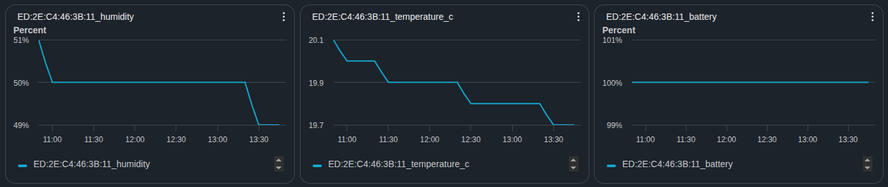

# esp32-thermo-system

Seeed Studio XIAO ESP32C3 で動く、Zephyr RTOS の BLE の温度計システム。センサノードとゲートウェイからなる。

## 概要

このプロジェクトは、ESP32C3 マイクロコントローラの上で Zephyr RTOS を使って動く、BLE (Bluetooth Low Energy) の温度計システムです。

- **Thermo Node**: 温湿度センサと気圧センサを備えたエッジノード。温度、湿度、気圧のデータを BLE で配信する
- **Thermo Gateway**: 複数のノードから温度のデータを集めるゲートウェイ
- **thermon** (別のリポジトリ): ゲートウェイが AWS IoT Core を経由して DynamoDB に保存したデータを表示する、Android アプリ。データは、Cognito の未認証ロールで読み取る ([sluchin/thermon](https://github.com/sluchin/thermon)。手順は [docs/aws_dynamodb.md](docs/aws_dynamodb.md))

## プロジェクト構成

```text
esp32-thermo-system/
├── app/
│   ├── thermo-node/            # センサノード (AHT20 + BMP280 または DHT11, BLE, OLED, RTC, ブザー, ボタン, WiFi での時刻の取得)
│   │   ├── CMakeLists.txt
│   │   ├── Kconfig             # アプリのオプション (THERMO_DISPLAY など)
│   │   ├── prj.conf            # Zephyr 設定
│   │   ├── boards/             # Devicetree のオーバーレイ (XIAO ESP32C3 と拡張ボード)
│   │   ├── dts/bindings/       # Devicetree の binding (RTC, ブザー)
│   │   ├── drivers/            # PCF8563 の RTC ドライバ
│   │   ├── private/            # サブモジュール (起動画面, 起動音, ボタンの音の素材. なくてもビルドできる)
│   │   ├── src/                # ソースコード
│   │   └── tests/              # 単体テスト (Ztest + FFF)
│   ├── thermo-gateway/         # ゲートウェイ (BLE のスキャン, WiFi, AWS IoT Core への送信)
│   │   ├── CMakeLists.txt
│   │   ├── Kconfig
│   │   ├── prj.conf
│   │   ├── src/
│   │   └── tests/
│   ├── common/                 # 両方のアプリが使うもの (設定 cfg, AWS IoT Core への送信 cloud, NTP, 送る内容 payload, WiFi の接続 wifi_link, BLE の UUID, ログのレベル)
│   ├── version.cmake           # VERSION と git のハッシュをファームウェアに渡す (起動のログに出る)
│   └── warnings.txt            # コンパイラの警告オプション (warnings.cmake が読み込む)
├── VERSION                     # ファームウェアのバージョン (起動のログに出る)
├── docs/                       # ドキュメント (Markdown. Doxygen の入力にもなる)
│   ├── setup.md                # セットアップガイド
│   ├── aws_setup.md, aws_graph.md, aws_dynamodb.md  # AWS IoT Core, グラフ, DynamoDB
│   ├── simulation.md, native_sim_implementation.md  # native_sim でのシミュレーション
│   ├── debug_log.md            # ログの読み方
│   ├── sd_log.md               # SD カードの記録の形式と読み方
│   ├── test_integration.md     # 結合試験項目書 (実機)
│   ├── coding_style.md, misra.md  # コーディングスタイルと MISRA C
│   └── man/                    # 使っている Zephyr の API の日本語訳 (index.md から読む)
├── scripts/                    # ビルド, テスト, 整形, 書き込み, WiFi の設定などの補助スクリプト
├── .github/                    # GitHub Actions (workflows/build.yml, release.yml と, Docker イメージのアクション)
├── Dockerfile                  # 開発環境 (Docker)
├── docker-compose.yml          # ビルド, テスト, 解析などのサービス
├── Doxyfile                    # ドキュメントの生成 (Doxygen. 出力は build/docs/)
├── west.yml                    # West マニフェスト
├── TODO.md                     # 未対応の課題と今後の予定
└── README.md                   # このファイル
```

## Zephyr API のマニュアル (docs/man/)

`docs/man/` には、このプロジェクトが使う Zephyr (v4.3.0) の API の日本語訳を置いています。対象は、`app/` のソース (単体テストを除く) が呼ぶ API だけで、サブシステムごとの Markdown にまとめています。

- 入口は [docs/man/index.md](docs/man/index.md) です。サブシステムは、Bluetooth LE、カーネル、デバイスとドライバ、表示装置、ファイルシステム、ネットワーク、設定、シェル、ログ、システムのユーティリティの 10 ファイルです。ほかに、テストの道具 ([ztest.md](docs/man/ztest.md)、[fff.md](docs/man/fff.md)) があります。
- 各 API には、関数のシグネチャ、説明、引数、戻り値、注意と、このリポジトリで呼んでいる箇所 (GitHub のソースの行へのリンク) を載せています。
- 訳の元は、Zephyr のヘッダの Doxygen コメントです。正は英語の原文なので、細かい挙動は、ヘッダか公式の文書で確かめてください。
- ソースを解析した文書は、`app/*/docs/` にあります。

## クイックスタート

### シミュレーション（推奨・最速）

ハードウェアなしで、Linux PC の上でテストするときの手順です。

```bash
# ビルド
docker compose run --rm build-node-sim
docker compose run --rm build-gateway-sim

# 実行
./build/thermo-node-sim/zephyr/zephyr.exe &
./build/thermo-gateway-sim/zephyr/zephyr.exe
```

詳細は [docs/simulation.md](docs/simulation.md) を参照してください。

### Docker を使用したビルド

Docker と Docker Compose がインストールされていれば、この方法が最も簡単です。

サービス名に `-node` か `-gateway` を付けると、そのアプリだけを実行します (`build-node` `build-gateway` `test-node` `coverage-gateway` など)。付けないと、Thermo Node と Thermo Gateway を順に実行します。共有のコード (`app/common`) の単体テストは `test-common` と `coverage-common`、シミュレーション用のビルドは `build-node-sim` と `build-gateway-sim` です。

```bash
# 対象が node と gateway の場合
docker compose run --rm build

# インタラクティブ開発シェル
docker compose run --rm dev

# 生成物 (build/) を全て消す (次のビルドは最初からやり直す)
docker compose run --rm clean
```

### docker compose のオプション (環境変数)

オプションは、環境変数で渡します (`docker compose run --rm` の前に書く)。読むのは、ビルドのサービス (`build` `build-node` `build-gateway`) だけです。省略すると、既定の値になります。

| 環境変数 | 値 | 既定 | 対象 | 内容 |
|:---|:---|:---|:---|:---|
| `THERMO_DEBUG_LOG` | `ON` / `OFF` | `OFF` | node と gateway | `LOG_DBG` と 16 進ダンプを有効にする |
| `THERMO_DISPLAY` | `y` / `n` | `y` | node | OLED、グラフ、ボタン |
| `THERMO_RTC` | `y` / `n` | `y` | node | RTC (PCF8563) |
| `THERMO_BUZZER` | `y` / `n` | `y` | node | ブザー (起動音とボタンの音) |
| `THERMO_SENSOR` | `aht20_bmp280` / `dht11` | `aht20_bmp280` | node | 温湿度センサ (`aht20_bmp280`: AHT20 + BMP280 のモジュール。気圧も送る。`dht11`: DHT11) |
| `THERMO_DHT_LOCK_IRQS` | `y` / `n` | `y` | node | DHT11 の読み取りの間、割り込みを止める (`THERMO_SENSOR=dht11` のときだけ) |
| `UID` / `GID` | 数値 | `0` | 全て | 生成物の所有者 (`export UID GID=$(id -g)` で、自分にする) |

※「対象」が node のオプションは、gateway のビルドでは使いません。

### 単体テストと静的解析

単体テストは、Zephyr の Ztest と FFF (モック) で書いてあり、`native_sim` の上で実行します。テストは、`app/thermo-node/tests/`、`app/thermo-gateway/tests/` と、共有のコードの `app/common/tests/` にあります。

```bash
# 対象が node と gateway の場合
# 単体テスト
docker compose run --rm test
# カバレッジ (行と分岐が 100% でなければ失敗する)
docker compose run --rm coverage
# 静的解析 (gcc -fanalyzer. 指摘があれば失敗する)
docker compose run --rm analyze
# ドキュメント (Doxygen. build/docs/index.html を開く. 警告があれば失敗する)
docker compose run --rm docs
```

### 整形と lint

コーディングスタイルは Zephyr の規約に合わせています (違う点は [docs/coding_style.md](docs/coding_style.md))。

```bash
# 対象が node と gateway の場合
# 整形の確認 (整形が必要なら失敗する)
docker compose run --rm format
# 整形してファイルを書き換える
docker compose run --rm format-fix
# Zephyr の checkpatch.pl による検査
docker compose run --rm lint
# 行末の空白の確認 (全てのテキストファイル)
docker compose run --rm whitespace
```

### ローカル開発環境構築

Docker を使用しない場合は、[docs/setup.md](docs/setup.md) を参照してください。

```bash
# West ワークスペース初期化
west init -l .
# Thermo Node をビルド (ESP32C3用)
west build -b xiao_esp32c3 app/thermo-node
# Thermo Gateway をビルド (ESP32C3用)
west build -b xiao_esp32c3 app/thermo-gateway
# Thermo Node をビルド (シミュレーション)
west build -b native_sim/native/64 app/thermo-node -d build/thermo-node-sim -- -DCONF_FILE=prj-native_sim.conf
# Thermo Gateway をビルド (シミュレーション)
west build -b native_sim/native/64 app/thermo-gateway -d build/thermo-gateway-sim -- -DCONF_FILE=prj-native_sim.conf
```

### デバッグログ

`LOG_DBG` と `LOG_HEXDUMP_DBG` (BLE で送受信したデータの 16 進ダンプ) は、通常のビルドでは、コードごと消えます。有効にするときは、cmake のオプション `THERMO_DEBUG_LOG` を `ON` にしてビルドします。
`THERMO_LOG_LEVEL=4` (DBG) は、アプリのソース (`app/thermo-*/src/`) だけに付きます (`app/common/thermo_log.h`)。Zephyr のモジュール (Bluetooth、ネットワーク、mbedTLS など) は、`CONFIG_LOG_DEFAULT_LEVEL` (3) のままです。全体を DBG にすると、ログが多すぎてスタックが足りなくなり、動かなくなるためです。Zephyr のモジュールのログが必要なときは、`-DCONFIG_NET_LOG=y -DCONFIG_NET_SOCKETS_LOG_LEVEL_ERR=y` などを個別に足してください ([docs/aws_setup.md](docs/aws_setup.md) の 5.1 を参照)。

```bash
# Docker: 環境変数 THERMO_DEBUG_LOG を ON にして build-* のサービスを実行する (既定は OFF)
THERMO_DEBUG_LOG=ON docker compose run --rm build-node
THERMO_DEBUG_LOG=ON docker compose run --rm build-gateway

# West (Docker を使わない場合)
west build -p always -b xiao_esp32c3 app/thermo-node -- -DTHERMO_DEBUG_LOG=ON
```

gateway がスキャンで受け取る広告データは大量に届くので、その 16 進ダンプは、50 件に 1 回だけ出します (`app/thermo-gateway/src/ble.c` の `ADV_HEXDUMP_EVERY`。`THERMO_DEBUG_LOG=ON` のときだけ有効)。

ログの読み方 (16 進ダンプの見方と、SwitchBot の受信から AWS への送信までの流れ) は、[docs/debug_log.md](docs/debug_log.md) を参照してください。

前のビルドが残っていると、設定を切り替えても反映されないことがあります。そのときは、ビルドのディレクトリ (`build/thermo-node` など) を削除して、ビルドし直します (west は `-p always`)。

### フラッシング

```bash
# ビルドしたあと, USB で接続して実行する
# XIAO ESP32C3 は USB を内蔵しているので, ポートは /dev/ttyACM0 (macOS は /dev/tty.usbmodem*)
esptool -p /dev/ttyACM0 write-flash 0x0 build/thermo-gateway/zephyr/zephyr.bin

# スクリプト (TARGET は node / gateway. PORT の既定値は /dev/ttyACM0. 2 台つなぐときは台ごとに PORT を指定する)
scripts/flash.sh gateway /dev/ttyACM0
```

## 機能

### Thermo Node

- 温湿度センサと気圧センサ (AHT20 + BMP280 のモジュール。I2C) から、Zephyr のセンサ API で値を読む (配線は [docs/setup.md](docs/setup.md) の「Thermo ノードのセンサ」)。ビルドのオプション (`THERMO_SENSOR=dht11`) で、DHT11 (気圧なし) に替えられる。Devicetree を書き換えれば、ADC のアナログセンサ (LM35 など) にも替えられる。
- 温度、湿度、気圧のデータを、BLE の GATT サービスで配信する。
- 拡張ボードの OLED に、温度、湿度、日付、時刻と、温度と湿度のグラフを表示する。グラフは、直近の約 6 時間を示す (再起動のあとは、SD カードの記録から戻す)。
  - ユーザボタンで、ページを切り替える。
  - OLED は、起動のときとボタンを押したときに点灯して、10 秒たつと消える。消えている間にボタンを押すと、点灯する。
  - 時刻は、拡張ボードの RTC (PCF8563) から読む。RTC は、ゲートウェイから BLE で受け取った時刻に合わせる。
  - 設定は、[docs/setup.md](docs/setup.md) の「OLED の表示と時刻」を参照する。`THERMO_DISPLAY=n` と `THERMO_RTC=n` で、別々に外せる。
- ゲートウェイにつながらない測定が 5 回続いたら、ノードは、WiFi で AWS IoT Core に直接 MQTT で送る。ゲートウェイにつながったら止める。5 回失敗したらあきらめる。
  - 全ての測定値 (5 秒ごと) を、送信済みフラグつきで、拡張ボードの SD カードに保存する。最大 100000 件で、超えたら古い記録から上書きする。
  - BLE も WiFi も使えない間は、未送信のまま保存し続ける。つながったら、測った時刻のまま古い順に送る。
  - 手順は [docs/setup.md](docs/setup.md) の「ゲートウェイにつながらないときの、WiFi での直接の送信と、SD カードへの保存」を、ノードごとの証明書は [docs/aws_setup.md](docs/aws_setup.md) の 7 章を参照する。
- ノードのログも、テキストで SD カードに保存する (`boot.log`: 起動から 60 秒の全てのログ、`error.log`: エラーのログ。形式は [docs/sd_log.md](docs/sd_log.md))。
- 起動のときに、OLED に約 3 秒の起動画面を出して、ブザーで短いメロディを鳴らす。ボタン (D1) を押すと、ページを切り替えて、ブザーで短い音を鳴らす。
- RTC に時刻がないときは、ノード自身が WiFi と SNTP で時刻を取る (BLE の予備)。起動の 1 分後から 1 分ごとに確かめて、取れたら WiFi を切る。最大 5 回までやり直す ([docs/setup.md](docs/setup.md) の「WiFi での時刻の取得」)。
- UART のシリアルコンソールに、ログを出す。

### Thermo Gateway

- BLE のスキャンで周辺のノードを見つけ、GATT で接続して、温度、湿度、気圧の通知を受け取る (最大 3 台。気圧を送らない以前のノードからも受け取れる)。
- SwitchBot 屋外用温湿度計 (Outdoor Meter) のアドバタイズを、接続せずに受け取る。温度 (℃)、湿度、電池残量を、10 秒に 1 回 AWS IoT Core に送る。
- 温度、湿度、気圧を、WiFi と MQTT (TLS。クライアント証明書による相互認証) で、AWS IoT Core に送る。設定の手順は [docs/aws_setup.md](docs/aws_setup.md)、届いたデータをグラフにする手順は [docs/aws_graph.md](docs/aws_graph.md)、DynamoDB に保存してアプリから読む手順は [docs/aws_dynamodb.md](docs/aws_dynamodb.md) にある。
- SNTP で同期した時刻を、接続したノードに、BLE (GATT の書き込み) で 1 時間ごとに渡して、ノードの RTC を合わせる ([docs/setup.md](docs/setup.md) の「ゲートウェイからの時刻の同期」)。
- WiFi、エンドポイント、証明書は、シェルの `thermo` コマンドで設定して、フラッシュに保存する。
- デバッグ用のシェルを使える。

AWS IoT Core に届いた SwitchBot のデータを、CloudWatch のダッシュボードに表示した例です。

<a href="docs/assets/aws-dashboard-thermo.png"></a>

## 対応ハードウェア

- **MCU**: ESP32C3
- **開発ボード**: Seeed Studio XIAO ESP32C3
- **通信**: BLE 5.0
- **温湿度センサ**: AHT20 + BMP280 のモジュール (既定) か、DHT11 (ビルドのオプション `THERMO_SENSOR` で選ぶ)

### 温湿度センサの精度

精度も分解能も、AHT20 のほうがずっと良いです (値は、各データシートのもの。AHT20 の精度は代表値)。

| 項目           | DHT11                                                | AHT20 (+ BMP280)          |
| :------------- | :--------------------------------------------------- | :------------------------ |
| 温度の精度     | ±2 ℃                                                 | ±0.3 ℃                    |
| 温度の分解能   | 1 ℃                                                  | 0.01 ℃                    |
| 温度の範囲     | 0〜50 ℃                                              | −40〜85 ℃                 |
| 湿度の精度     | ±5 %RH                                               | ±2 %RH                    |
| 湿度の分解能   | 1 %RH                                                | 0.024 %RH                 |
| 湿度の範囲     | 20〜80 %RH 程度                                      | 0〜100 %RH                |
| 気圧           | なし                                                 | あり (BMP280)             |
| つなぎ方       | 専用の 1 本線 (タイミングに厳しい。読み取りの間、割り込みを止める) | I2C (OLED、RTC と同じバス) |

- DHT11 の値は 1 ℃、1 % 刻みなので、グラフが階段状になります。AHT20 の値は、小数 1 桁 (送る値の単位) まで変わります。
- DHT11 は、ほかの処理の割り込みで、読み損ねることがあります。`THERMO_DHT_LOCK_IRQS` を有効にすると、読み取りの間は割り込みを止めて、これを防ぎます。AHT20 (I2C) には、この心配がありません。

## CI/CD

GitHub Actions で、次の確認を自動で実行します。

- **ビルド** (`build` ジョブ): 実機 (ESP32C3) 用とシミュレーション (`native_sim`) 用に、両方のアプリをビルドします。警告が出たら失敗します
- **単体テスト** (`test` ジョブ): Thermo Node、Thermo Gateway と、共有のコード (`app/common`) の単体テストです
- **カバレッジ** (`coverage` ジョブ): 行と分岐が 100% でなければ失敗します
- **ドキュメント** (`docs` ジョブ): Doxygen。警告があれば失敗します
- **静的解析** (`analyze` ジョブ): gcc `-fanalyzer`。指摘があれば失敗します
- **整形と lint** (`lint` ジョブ): clang-format による整形の確認、Zephyr の `checkpatch.pl`、行末の空白の確認。指摘があれば失敗します
- **アーティファクトの保存**: ビルドの成果物 (ELF と BIN。シミュレーションは実行ファイル) と、各ジョブのログを保存します。保存期間は 3 日です。`cleanup` ジョブが、push のたびに、3 日より前の実行 (ログと artifact) を削除します

ジョブは、ローカルと同じ Docker イメージで、`docker compose` のサービスを実行します。イメージのレイヤーは、キャッシュします。

## 開発フロー

1. push のたびに、GitHub Actions が、ビルド、単体テスト、静的解析、lint などを実行する
2. PR をマージする前に、全てのジョブの成功を確かめる
3. main ブランチにマージする

### rebase したあとの push

`git rebase` で履歴を書き換えたあとは、通常の `git push` が拒否されます。次のコマンドで push します。

```bash
git push --force-with-lease --force-if-includes origin <ブランチ名>
```

- `--force` は使いません。リモートに、手元に取り込んでいないコミット (他の人や別の環境の push) があると、push は失敗します。失敗したら `git fetch` で取り込んでからやり直します。

## デバッグ

### シリアルコンソール接続

```bash
picocom -b 115200 /dev/ttyACM0

# リセットのたびに USB が切れるので, 起動のログを見るときはつなぎ直しを繰り返す (読み取りだけ. 入力は送れない)
while true; do [ -c /dev/ttyACM0 ] && stty -F /dev/ttyACM0 115200 raw -echo && cat /dev/ttyACM0; sleep 0.3; done
```

### Zephyr ログレベル

`prj.conf` で、次のように設定できます。

```conf
CONFIG_LOG_MODE_IMMEDIATE=y
CONFIG_LOG_DEFAULT_LEVEL=4  # DEBUG レベル
```

## トラブルシューティング

問題が起きたときは、[docs/setup.md](docs/setup.md) のトラブルシューティングを参照してください。未対応の課題と今後の予定は、[TODO.md](TODO.md) にあります。

## リリース

`v0.1.0` のようなタグを push すると、GitHub Actions の `release.yml` が、GitHub Releases のドラフトを作ります。中身を確かめてから、手で公開します。タグを打たずに試すときは、Actions の Release を手動で実行します。成果物は、Artifacts に保存されます。

## ライセンス

[LICENSE](./LICENSE) を参照してください。

## リンク

- [thermon](https://github.com/sluchin/thermon): DynamoDB のデータを読み取る Android アプリ (Kotlin)
- [Zephyr Project](https://www.zephyrproject.org/)
- [ESP32C3 データシート](https://www.espressif.com/sites/default/files/documentation/esp32-c3_datasheet_en.pdf)
- [XIAO ESP32C3 Wiki](https://wiki.seeedstudio.com/xiao_esp32c3_getting_started/)
