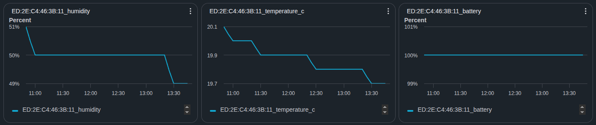

# esp32-thermo-system

Zephyr RTOS-based BLE thermometer system featuring a sensor node and a gateway for Seeed Studio XIAO ESP32C3.

## 概要

このプロジェクトは、ESP32C3 マイクロコントローラ上で Zephyr RTOS を使用したBLE（Bluetooth Low Energy）サーモメータシステムです。

- **Thermo Node**: 温度センサを備えたエッジノード。温度データを BLE 経由で配信
- **Thermo Gateway**: 複数のノードから温度データを収集・集約するゲートウェイ
- **thermon** (別のリポジトリ): ゲートウェイが AWS IoT Core 経由で DynamoDB に保存したデータを、Cognito の未認証ロールで読み取って表示する Android アプリ ([sluchin/thermon](https://github.com/sluchin/thermon)。手順は [AWS_DYNAMODB.md](AWS_DYNAMODB.md))

## プロジェクト構成

```
esp32-thermo-system/
├── app/
│   ├── thermo-node/            # センサノード (DHT11、BLE、OLED、RTC、ブザー、ボタン、WiFi での時刻の取得)
│   │   ├── CMakeLists.txt
│   │   ├── Kconfig             # アプリのオプション (THERMO_DISPLAY など)
│   │   ├── prj.conf            # Zephyr 設定
│   │   ├── boards/             # Devicetree のオーバーレイ (XIAO ESP32C3 と拡張ボード)
│   │   ├── dts/bindings/       # Devicetree の binding (RTC、ブザー)
│   │   ├── drivers/            # PCF8563 の RTC ドライバ
│   │   ├── private/            # サブモジュール (起動画面、起動音、ボタンの音の素材。なくてもビルドできる)
│   │   ├── src/                # ソースコード
│   │   └── tests/              # 単体テスト (Ztest + FFF)
│   ├── thermo-gateway/         # ゲートウェイ (BLE のスキャン、WiFi、AWS IoT Core への送信)
│   │   ├── CMakeLists.txt
│   │   ├── Kconfig
│   │   ├── prj.conf
│   │   ├── src/
│   │   └── tests/
│   ├── common/                 # 両方のアプリが使う、BLE の UUID とログのレベル
│   └── warnings.txt            # コンパイラの警告オプション (warnings.cmake が読み込む)
├── man/                        # 使っている Zephyr の API の日本語訳 (index.md から読む)
├── scripts/                    # ビルド、テスト、整形、書き込み、WiFi の設定などの補助スクリプト
├── .github/                    # GitHub Actions (workflows/build.yml と、Docker イメージのアクション)
├── Dockerfile                  # 開発環境 (Docker)
├── docker-compose.yml          # ビルド、テスト、解析などのサービス
├── Doxyfile                    # ドキュメントの生成 (Doxygen)
├── west.yml                    # West マニフェスト
├── SETUP.md                    # セットアップガイド
├── SD_LOG.md                   # SD カードの記録の形式と読み方
├── TEST_INTEGRATION.md         # 結合試験項目書 (実機)
└── README.md                   # このファイル
```

## クイックスタート

### シミュレーション（推奨・最速）

ハードウェアなしで Linux PC 上でテストしたい場合：

```bash
# ビルド
docker compose run --rm build-node-sim
docker compose run --rm build-gateway-sim

# 実行
./build/thermo-node-sim/zephyr/zephyr.exe &
./build/thermo-gateway-sim/zephyr/zephyr.exe
```

詳細は [SIMULATION.md](./SIMULATION.md) を参照してください。

### Docker を使用したビルド

Docker と Docker Compose がインストールされている場合、最も簡単な方法です：

サービス名に `-node` か `-gateway` を付けると、そのアプリだけを実行します (`build-node` `build-gateway` `test-node` `coverage-gateway` など)。シミュレーション用のビルドは、`build-node-sim` `build-gateway-sim` です。付けないと、Thermo Node と Thermo Gateway を、順に実行します。

```bash
# 「対象」が node、gateway の場合
docker compose run --rm build

# インタラクティブ開発シェル
docker compose run --rm dev

# 生成物 (build/ と docs/) を全て消す (次のビルドは、最初からやり直す)
docker compose run --rm clean
```

### docker compose のオプション (環境変数)

オプションは、環境変数で渡します (`docker compose run --rm` の前に書く)。ビルド (`build` `build-node` `build-gateway`) だけが読みます。省略すると、既定の値になります。

| 環境変数 | 値 | 既定 | 対象 | 内容 |
|:---|:---|:---|:---|:---|
| `THERMO_DEBUG_LOG` | `ON` / `OFF` | `OFF` | node と gateway | `LOG_DBG` と 16 進ダンプを有効にする |
| `THERMO_DISPLAY` | `y` / `n` | `y` | node | OLED、グラフ、ボタン |
| `THERMO_RTC` | `y` / `n` | `y` | node | RTC (PCF8563) |
| `THERMO_BUZZER` | `y` / `n` | `y` | node | ブザー (起動音とボタンの音) |
| `THERMO_DHT_LOCK_IRQS` | `y` / `n` | `y` | node | DHT11 の読み取りの間、割り込みを止める |
| `UID` / `GID` | 数値 | `0` | 全て | 生成物の所有者 (`export UID GID=$(id -g)` で、自分にする) |

※「対象」が node のオプションは、gateway のビルドでは使いません。

### 単体テストと静的解析

単体テストは Zephyr の Ztest と FFF (モック) で書かれていて、`native_sim` 上で実行します (`app/thermo-node/tests/` と `app/thermo-gateway/tests/`)。

```bash
# 「対象」が node、gateway の場合
# 単体テスト
docker compose run --rm test
# カバレッジ (行と分岐が 100% でなければ失敗する)
docker compose run --rm coverage
# 静的解析 (gcc -fanalyzer。指摘があれば失敗する)
docker compose run --rm analyze
# ドキュメント (Doxygen。docs/index.html を開く。警告があれば失敗する)
docker compose run --rm docs
```

### 整形と lint

コーディングスタイルは Zephyr の規約に合わせています (違う点は [CODING_STYLE.md](CODING_STYLE.md))。

```bash
# 「対象」が node、gateway の場合
# 整形の確認 (整形が必要なら失敗する)
docker compose run --rm format
# 整形して、ファイルを書き換える
docker compose run --rm format-fix
# Zephyr の checkpatch.pl による検査
docker compose run --rm lint
# 行末の空白の確認 (全てのテキストファイル)
docker compose run --rm whitespace
```

### ローカル開発環境構築

Docker を使用しない場合は、[SETUP.md](./SETUP.md) を参照してください。

```bash
# West ワークスペース初期化
west init -l .
# Thermo Node をビルド（ESP32C3用）
west build -b xiao_esp32c3 app/thermo-node
# Thermo Gateway をビルド（ESP32C3用）
west build -b xiao_esp32c3 app/thermo-gateway
# Thermo Node をビルド（シミュレーション）
west build -b native_sim/native/64 app/thermo-node -d build/thermo-node-sim -- -DCONF_FILE=prj-native_sim.conf
# Thermo Gateway をビルド（シミュレーション）
west build -b native_sim/native/64 app/thermo-gateway -d build/thermo-gateway-sim -- -DCONF_FILE=prj-native_sim.conf
```

### デバッグログ

`LOG_DBG` と `LOG_HEXDUMP_DBG` (BLE で送受信したデータの 16 進ダンプ) は、通常のビルドでは、コードごと消えます。有効にするときは、cmake のオプション `THERMO_DEBUG_LOG` を `ON` にして、ビルドします。
アプリのソース (`app/thermo-*/src/`) だけに、`THERMO_LOG_LEVEL=4` (DBG) が付きます (`app/common/thermo_log.h`)。Zephyr のモジュール (Bluetooth、ネットワーク、mbedTLS など) は、`CONFIG_LOG_DEFAULT_LEVEL` (3) のままです。全体を DBG にすると、ログの量が多すぎて、スタックが足りなくなり、動かなくなるためです。Zephyr のモジュールのログが必要なときは、`-DCONFIG_NET_LOG=y -DCONFIG_NET_SOCKETS_LOG_LEVEL_ERR=y` などを、個別に足してください ([AWS_SETUP.md](AWS_SETUP.md) の 5.1 を参照)。

```bash
# Docker: 環境変数 THERMO_DEBUG_LOG を ON にして、build-* のサービスを実行する (既定は OFF)
THERMO_DEBUG_LOG=ON docker compose run --rm build-node
THERMO_DEBUG_LOG=ON docker compose run --rm build-gateway

# West (Docker を使わない場合)
west build -p always -b xiao_esp32c3 app/thermo-node -- -DTHERMO_DEBUG_LOG=ON
```

gateway がスキャンで受け取る広告データの 16 進ダンプは、大量に届くので、50 要素に 1 回だけ出します (`app/thermo-gateway/src/ble.c` の `ADV_HEXDUMP_EVERY`。`THERMO_DEBUG_LOG=ON` のときだけ有効)。

ログの読み方 (16 進ダンプの見方、SwitchBot の受信から AWS への送信までの流れ) は、[DEBUG_LOG.md](DEBUG_LOG.md) を参照してください。

設定を切り替えるときは、前のビルドが残っていると、反映されないことがあるので、ビルドのディレクトリ (`build/thermo-node` など) を削除してから、ビルドし直します (west は `-p always`)。

### フラッシング

```bash
# ビルド後、USB で接続した状態で実行
# XIAO ESP32C3 は USB を内蔵しているので、ポートは /dev/ttyACM0 (macOS は /dev/tty.usbmodem*)
esptool -p /dev/ttyACM0 write-flash 0x0 build/thermo-gateway/zephyr/zephyr.bin

# スクリプト (TARGET は node / gateway。PORT の既定値は /dev/ttyACM0。2 台つなぐときは、台ごとに PORT を指定する)
scripts/flash.sh gateway /dev/ttyACM0
```

## 機能

### Thermo Node

- 温湿度センサ (DHT11) の読取 (Zephyr のセンサ API。配線は [SETUP.md](SETUP.md) の「Thermo ノードのセンサ」)。ADC のアナログセンサ (LM35 など) にも、Devicetree の書き換えで、替えられます
- BLE GATT サービスで、温度と湿度のデータを配信
- 拡張ボードの OLED に、温度、湿度、日付、時刻と、温度と湿度のグラフ (直近の約 6 時間。SD カードの記録から、再起動のあとも戻す) を表示 (ユーザボタンでページを切り替え。OLED は、起動のときとボタンを押したときに点灯して、10 秒たつと消える。消えている間にボタンを押すと、点灯する)。時刻は、拡張ボードの RTC (PCF8563) から読みます (RTC は、ゲートウェイから BLE で受け取った時刻に合わせます) (設定は [SETUP.md](SETUP.md) の「OLED の表示と時刻」。`THERMO_DISPLAY=n` と `THERMO_RTC=n` で、別々に外せます)
- ゲートウェイにつながらない測定が 5 回続いたら、ノードが、WiFi で、AWS IoT Core に、直接 MQTT で送る (ゲートウェイにつながったら止める。5 回失敗したらあきらめる)。全ての測定値 (5 秒ごと) は、送信済みフラグつきで、拡張ボードの SD カードに保存する (最大 100000 件。超えたら、古い記録から上書きする)。BLE も WiFi も使えない間は、未送信で保存し続けて、つながったときに、測った時刻のまま、古い順に送る ([SETUP.md](SETUP.md) の「ゲートウェイにつながらないときの、WiFi での直接の送信と、SD カードへの保存」。ノードごとの証明書は、[AWS_SETUP.md](AWS_SETUP.md) の 7 章)。
- ノードのログも、SD カードに、テキストで保存する (`boot.log`: 起動から 60 秒の全てのログ、`error.log`: エラーのログ。形式は [SD_LOG.md](SD_LOG.md))。
- 起動のときに、OLED に、約 3 秒の起動画面 (丸い絵が、ドットを食べながら走る) を出して、ブザーで、短いメロディを鳴らす (オリジナルの絵と曲。差し替えは、[SETUP.md](SETUP.md) の「起動画面と起動音」)。ボタン (D1) を押すと、ページを切り替えて、ブザーで、短い音を鳴らす (差し替えは、同じ「ボタンを押したときの音」)
- ログ出力（UART シリアルコンソール）

### Thermo Gateway
- BLE スキャンで周辺ノードを検出して、GATT で接続し、温度と湿度の通知を受信 (最大 3 台)
- SwitchBot 屋外用温湿度計 (Outdoor Meter) のアドバタイズ (接続しない) を受信して、温度 (℃)・湿度・電池残量を、10 秒に 1 回、AWS IoT Core に送信
- WiFi + MQTT (TLS、クライアント証明書による相互認証) で、AWS IoT Core に温度を送信 (設定手順は [AWS_SETUP.md](AWS_SETUP.md)。届いたデータをグラフにする手順は [AWS_GRAPH.md](AWS_GRAPH.md)。DynamoDB に保存して、アプリから読む手順は [AWS_DYNAMODB.md](AWS_DYNAMODB.md))
- SNTP で同期した時刻を、接続したノードに BLE (GATT の書き込み) で渡して、ノードの RTC を合わせる (1 時間ごと。[SETUP.md](SETUP.md) の「ゲートウェイからの時刻の同期」)
- 起動の 1 分後から 1 分ごとに、ノードの RTC に時刻がなければ、ノードが自分で WiFi と SNTP で時刻を取って、WiFi を切る (最大 5 回) (BLE の予備。[SETUP.md](SETUP.md) の「WiFi での時刻の取得」)
- WiFi・エンドポイント・証明書は、シェルの `thermo` コマンドで設定して、フラッシュに保存
- デバッグシェル対応

AWS IoT Core に届いた SwitchBot のデータを、CloudWatch のダッシュボードに表示した例です (左から、湿度、温度、電池残量。画像をクリックすると、拡大します)。

<a href="assets/aws-dashboard-thermo.png"></a>

## 対応ハードウェア

- **MCU**: ESP32C3
- **開発ボード**: Seeed Studio XIAO ESP32C3
- **通信**: BLE 5.0

## CI/CD

GitHub Actions により、以下の自動化が設定されています：

- **ビルド** (`build` ジョブ): 実機 (ESP32C3) 用とシミュレーション (`native_sim`) 用の、両アプリのビルド。警告が出たら失敗します
- **単体テスト** (`test` ジョブ): Thermo Node / Thermo Gateway の単体テスト
- **静的解析** (`analyze` ジョブ): gcc `-fanalyzer`。指摘があれば失敗します
- **整形と lint** (`lint` ジョブ): clang-format による整形の確認、Zephyr の `checkpatch.pl`、行末の空白の確認。指摘があれば失敗します
- **アーティファクト保存**: ビルド成果物 (ELF/BIN、シミュレーションは実行ファイル) と、各ジョブのログを自動保存します。保存期間は 3 日で、`cleanup` ジョブが、3 日より前の実行 (ログと artifact) を、push のたびに削除します

ジョブは、ローカルと同じ Docker イメージで `docker compose` のサービスを実行します。イメージのレイヤーは、キャッシュされます。

## 開発フロー

1. `ccr-*` ブランチで機能開発
2. Push 時に GitHub Actions で、ビルド・単体テスト・静的解析・lint を自動実行
3. PR をマージする前に、全ジョブの成功を確認
4. main ブランチへのマージ

### rebase したあとの push

`git rebase` でコミットの履歴を書き換えたあとは、通常の `git push` は拒否されるので、次のコマンドで push します。

```bash
git push --force-with-lease --force-if-includes origin <ブランチ名>
```

- `--force` は使わない。リモートに、手元に取り込んでいないコミット (他の人や別の環境の push) があれば、push は失敗する。失敗したら、`git fetch` で取り込んでから、やり直す。
- push は、ユーザーに依頼されたときだけ行う (AI エージェントも同じ)。

## デバッグ

### シリアルコンソール接続

```bash
picocom -b 115200 /dev/ttyACM0

# リセットのたびに USB が切れるので, 起動のログを見るときは, つなぎ直しを繰り返す (読み取りだけ. 入力は送れない)
while true; do [ -c /dev/ttyACM0 ] && stty -F /dev/ttyACM0 115200 raw -echo && cat /dev/ttyACM0; sleep 0.3; done
```

### Zephyr ログレベル

`prj.conf` で以下のように設定可能：

```conf
CONFIG_LOG_MODE_IMMEDIATE=y
CONFIG_LOG_DEFAULT_LEVEL=4  # DEBUG レベル
```

## トラブルシューティング

問題が発生した場合は、[SETUP.md](./SETUP.md) のトラブルシューティングセクションを参照してください。

## ライセンス

[LICENSE](./LICENSE) を参照してください。

## リンク

- [thermon](https://github.com/sluchin/thermon): DynamoDB のデータを読み取る Android アプリ (Kotlin)
- [Zephyr Project](https://www.zephyrproject.org/)
- [ESP32C3 データシート](https://www.espressif.com/sites/default/files/documentation/esp32-c3_datasheet_en.pdf)
- [XIAO ESP32C3 Wiki](https://wiki.seeedstudio.com/xiao_esp32c3_getting_started/)
